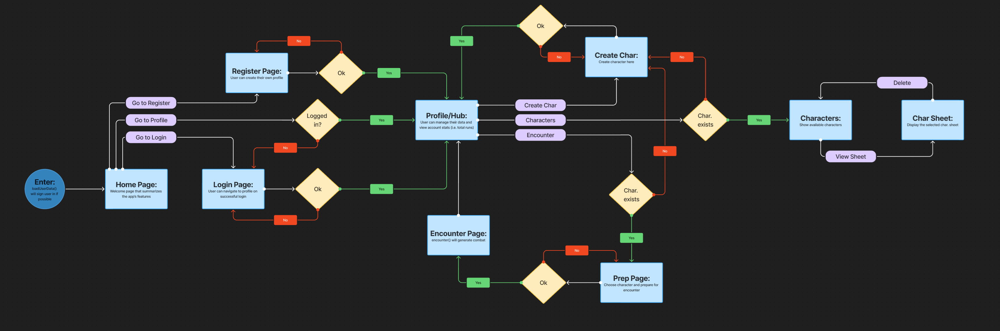
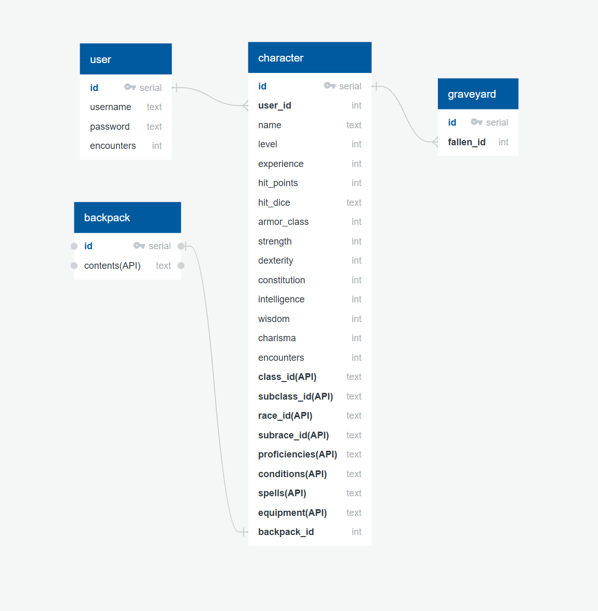

# Capstone-Project

"D&D Fight!" https://www.freepublicapis.com/dungeons-and-dragons-api
Create a random monster for the User to battle. User would pick class and the monster would be generated randomly depending on User's current level. User's character will be saved via Local Storage (my API to hold users). Will need to figure out how to create enviroment. Maybe make a consistent area for all encounters, like a "game board?"

## API Endpoints
https://docs.google.com/document/d/1Srm3zEfvewNFC8w2pWpa0vXxVuwCiHtF6h_Me1sj1R0/edit?usp=drive_link

## Application Workflow: 

## Database Diagram: 

